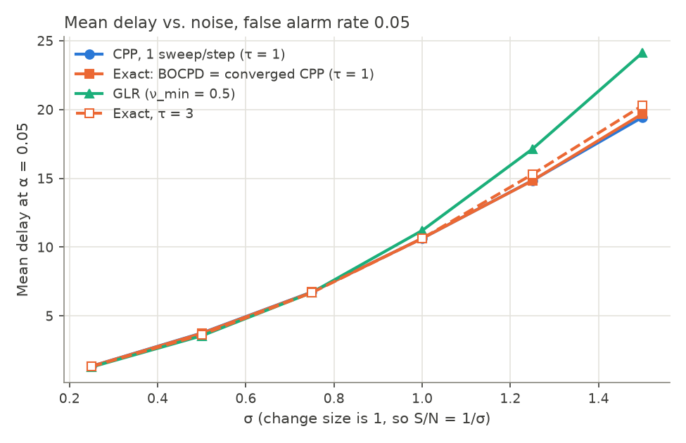

# ChangePoint

> **If you came here from "A novel changepoint detection algorithm"** (Downey, [arXiv:0812.1237](https://arxiv.org/abs/0812.1237)): that paper has been superseded. Use **Bayesian online changepoint detection** (BOCPD; Adams & MacKay 2007, [arXiv:0710.3742](https://arxiv.org/abs/0710.3742)), which computes the posterior the paper was after exactly, in O(n) time per step. See also the recursions of Fearnhead (2006) and the online version of Fearnhead & Liu (2007). The 2008 implementation had errors, so its results should not be relied on.

This repository archives the 2006–2008 work and a 2026 follow-up. The follow-up corrects the algorithm and shows that it is equivalent to BOCPD.

## What happened

In 2006 I drafted a Bayesian algorithm for tracking changepoints in network measurements. The key quantity was P(i⁺), the probability that index *i* is the most recent changepoint. The algorithm computed it by iterating a system of equations that also involves P(i⁺⁺), the second-to-last changepoint. The paper was posted to arXiv in 2008.

Similar work was happening in parallel. Fearnhead (2006) gave exact recursions for multiple-changepoint problems, and Adams & MacKay (2007) published BOCPD, whose "run-length posterior" is exactly P(i⁺). Those are the papers to read and cite.

In 2026 I revisited the code and found several errors (listed in [summary.md](summary.md)). Once they are fixed:

- **The recursion is exact, and its P(i⁺) is the BOCPD posterior.** Tests check both against brute-force enumeration of every possible set of changepoints.
- **The iteration is unnecessary.** BOCPD computes P(i⁺) directly in O(n) per step. P(i⁺⁺), the one thing the old algorithm adds, follows from BOCPD's stored posteriors with a single sum.
- **The paper's main empirical claim holds, qualitatively.** A Bayesian detector beats the GLR test when the signal-to-noise ratio is low. But the advantage belongs to the Bayesian approach in general, not to this algorithm.

## Implementations of BOCPD

- Python: [`bayesian_changepoint_detection`](https://github.com/hildensia/bayesian_changepoint_detection) (online BOCPD and Fearnhead's offline method)
- Python, short and readable: [`bocd`](https://github.com/gwgundersen/bocd), with an accompanying blog post by Gregory Gundersen
- R: [`ocp`](https://cran.r-project.org/package=ocp)

The code in [compare/](compare/) is a small, tested reference implementation for checking results and understanding the method, not a library.

## What's here

| Path | Contents |
|---|---|
| [summary.md](summary.md) | The algorithm, the errors in the original code, the 2026 results, and conclusions |
| [compare/](compare/) | 2026 code (Python 3): BOCPD, P(i⁺⁺) from BOCPD's history, the corrected iterative algorithm, GLR, tests, and experiments |
| [paper/](paper/) | The paper (2006 and 2008 versions), LaTeX sources, slides, and a Markdown conversion ([paper/paper.md](paper/paper.md)) |
| [code/](code/) | The original 2006–2008 code (Python 2), kept as a record; it does not run as-is |
| [REFERENCES.md](REFERENCES.md) | The papers to use instead, and the changepoint papers cited in the 2008 paper |
| [PROJECT_BOARD.md](PROJECT_BOARD.md) | Task tracking for this repository |

### Running the 2026 code

```bash
conda env create -f environment.yml
conda activate ChangePoint
cd compare
python -m pytest test_cpp.py       # check CPP and BOCPD against brute-force enumeration
python experiments.py examples     # P(i+) and P(i++) on the paper's examples
python experiments.py detection    # mean delay vs. false alarm rate, BOCPD vs. GLR
```

Results are written to `compare/results/`:



## License

The code is under the [MIT License](LICENSE). The text, figures, and results are under [CC BY 4.0](LICENSE-text).

## Inventory

### paper/

| File | Description |
|---|---|
| `paper.md` | Markdown conversion of the latest version, with figures in `figures/` |
| `paper.tex` | LaTeX source of the 2008 version; matches `downey08changepoint.pdf` and arXiv v1 |
| `paper.tex.bak` | Much earlier, shorter draft, "Changepoint detection in network measurements" |
| `short.tex` | Short version, "Changepoint detection in network measurements" |
| `downey06changepoint.pdf` | November 2006 version, "A changepoint detection algorithm for network measurements" |
| `downey08changepoint.pdf` | 2008 version, as distributed |
| `downey0[68]changepoint.slides.pdf`, `slides.tex` | Talk slides |
| `downey0[68]changepoint.bib`, `paper.bib` | Bibliography |
| `figures/` | PNG versions of the paper's figures, converted from the EPS files |
| `arxiv/` | The arXiv submission: same text as `paper.tex` with local figure paths |
| `sdsc/` | Slides from the 2006 talk at SDSC |
| `sigmetrics/` | Version submitted to SIGMETRICS (not published) |
| `talk/` | Talk abstracts |
| `Makefile`, `clean.tcl` | Build scripts |

### code/

Python 2. Several scripts import modules that are not included (`Gui`, `Hist`). `notes.txt` records the commands that produced each result file.

| File | Description |
|---|---|
| `Change4.py` | The version used for the paper: the recursion, data generators, GLR, and the experiment driver |
| `Change3.py`, `Change2.py` | Earlier versions of the same code |
| `Change.py` | Earliest experiment: a fixed population of two-window hypotheses with running statistics, randomly split and pruned |
| `GLR.py` | Standalone GLR, used to calibrate thresholds |
| `notes.txt`, `todo.txt` | Lab notebook and to-do list |
| `graph.py`, `colorchart.py`, `graychart.py`, `old_graph.py` | Helpers for jgraph (`.jgr`) plots |
| `example.py`, `nile.py`, `nile2.py`, `series.py`, `var.py`, `matfar.py`, `matsig.py` | Scripts that turn result files into the paper's figures (`.jgr` → `.eps`) |
| `nile.dat` | Nile river annual flow at Aswan, 1871–1970 |
| `result.*`, `mat_vs_far.*`, `matsig.*`, `tbfa.*` | Experiment outputs: mean alarm time vs. false alarm rate and vs. σ; time between false alarms for GLR thresholds |
| `data.*`, `like*`, `p.*`, `pp.*`, `pred.*`, `prob.*`, `cpp.*`, `pcpp.*`, `nile.p.*`, `var.*`, `t.1.0`, `sum`, `temp`, `test1`–`test4` | Intermediate outputs from individual runs (`test3` and `test4` are identical) |
| `change3.test`, `change4.test` | Regression-test outputs comparing versions 3 and 4 |
| `profile.out` | Profiler output |
| `old/` | Older copy of the Nile files |
